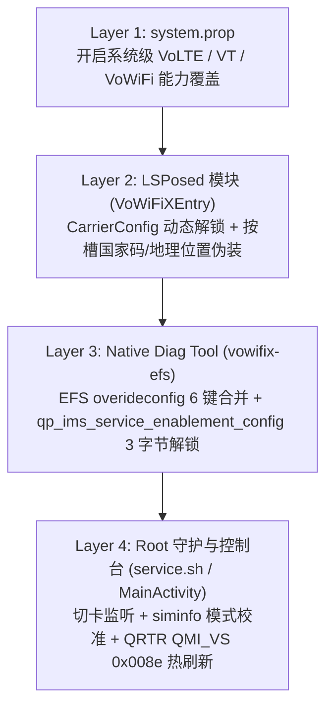

# VoWiFiX

原生基带 VoWiFi（Wi-Fi Calling）与跨国漫游全栈增强方案（高通骁龙平台）。

VoWiFiX 将 **Root 基带 EFS 层工具**（`vowifix-efs` + 切卡自动守护）与 **LSPosed 框架增强 + 极简原生控制台 App**（`< 100 KB`，零第三方依赖）结合为一体化工程：在不改写运营商原始 `MBN` 镜象文件的前提下，从属性层、Android IMS/框架层、高通基带 EFS 与 `siminfo` 持久层四个维度打通跨运营商、跨卡热切换与国际漫游下的原生 VoWiFi 能力。

---

## 核心特性

- **双层基带 EFS 安全合并与漫游解锁**
  - 原生支持高通传统 `/dev/diag` (`diagchar`) 与 GKI 新平台 `diag-router`（`AF_UNIX` `SOCK_SEQPACKET`）双后端自动探测（`EFS2_DIAG_*`），对 `/efsprofiles/overideconfig`（及双卡副槽 `_Subscription01`）执行只增不毁、逐字节校验的 `6` 键通用配置合并，保留各卡原有 APN/端口/加密策略不变；
  - 同步对活跃槽位 `/nv/item_files/ims/qp_ims_service_enablement_config` 执行最小 `3` 字节解锁（启用 Wi-Fi 通话总开关、将移动网络优先改回 Wi-Fi 优先、解除漫游强制禁用 VoWiFi），破除部分海外或漫游 SIM 卡的基带硬锁。
- **跨卡热切换免重启自适应**
  - 常驻守护进程监听双卡 `gsm.sim.state` 与 `MCC/MNC` 变动，在切卡或漫游就绪后自动完成 EFS 合并、`telephony/siminfo` 历史策略校准，并通过 Qualcomm `QRTR` (`AF_QIPCRTR`) 按变更卡槽下发 `QMI_VS` 订阅绑定（`0x0021`）+ `0x008e` 独立/双槽热刷新（热插副卡时不打断主卡在线状态），无需重启即可生效；
  - 自 `v1.0.1` 起引入多后端 Diag 传输层抽象与无副作用探测（`vowifix-efs detect`）：单文件静态二进制即可自动适配旧平台 `/dev/diag` 与骁龙 8 Gen 2 / 8 Gen 3 / 8 Elite 等 GKI 新平台的 `diag-router`；对极少数完全封禁 Diag 的商用 ROM 也会优雅切换至“上层解锁 + `siminfo` 校准 + QRTR 刷新”模式，消除开机等待超时与报错刷屏。
- **LSPosed 全作用域解锁与按槽伪装**
  - 绕过系统/ColorOS `CarrierConfig` 开关隐藏、Entitlement/Provisioning 云端资格校验，强制 `WIFI_PREFERRED` 与 `EPDG_ADDRESS_PLMN`；
  - 按卡槽自适应返回 SIM 归属 ISO 国家码并拦截基站/Wi-Fi PANI/CNI/地理位置上报（同时保留真实 `NITZ` 时区判定不受干扰）。
- **轻量原生控制台与快捷磁贴（`< 100 KB`）**
  - 纯 Java 17 + Android 原生 View 零三方库实现，支持系统浅色/深色主题自适应与 Edge-to-Edge 安全区适配；
  - 内置框架激活自检、后台守护开关、双卡与 EFS 状态诊断、一键热适配（含 `6s` 落盘倒计时）、原始备份一键还原、系统 `RadioInfo` 直达、控制中心快捷磁贴与桌面图标隐藏/恢复；
  - 未授予 Root 时自动降级为只读状态监控模式，绝不越权或强行提权。

---

## 为什么部分 SIM 卡或国际漫游拉不起 VoWiFi？

在实际使用不同运营商卡或出境漫游时，往往会遇到“同一台手机插 A 卡能秒出 VoWiFi，插 B 卡却始终停留在 VoLTE 或无反应”。通常存在四重叠加障碍：

1. **系统 `CarrierConfig` 与资格校验拦截**：系统未对冷门或境外运营商下发 `carrier_wfc_ims_available_bool` 等开关，或受 `carrier_wfc_provisioning_required_bool` / OEM 定制开关隐藏限制。
2. **定位与国家码泄露（Geo / PANI / CNI）**：部分运营商严格限制境外 IP / 非本土基站 PANI 与地理位置注册 VoWiFi，且 Android 多处定位服务（`LocaleTracker`、`CountryDetector`、Qualcomm CNE、IMS Geolocation）会将漫游所在国传给基带与 ePDG。
3. **高通基带 EFS 漫游硬锁与底层配置缺失**：
   - 不少运营商原厂 `mcfg_sw.mbn` 在 `/nv/item_files/ims/qp_ims_service_enablement_config`（1024 B）中写入了 **移动网络优先（`offset 0x09 = 0x03`/`0x04`）** 及 **漫游下强制禁用 VoWiFi（`offset 0x0D = 0x02`）**；
   - 高通原生 `ImsConfigImpl` 在源码层还会对漫游开关请求（`item == 26`）直接忽略并由基带本地决策接管，导致纯改 Android 上层无效。
4. **`telephony/siminfo` 历史策略锁定**：切换回曾经在本地“移动优先”状态下用过的 SIM 卡时，系统数据库残留的 `wfc_ims_mode=1` / `wfc_ims_roaming_mode=1`（或 `-1`）会覆盖新的 `CarrierConfig` 默认值。

---

## 四层协同架构



### 各层精准作用细节

| 层级 | 组件 / 目标路径 | 具体作用 |
| :--- | :--- | :--- |
| **Layer 1** | `root-module/system.prop` | 注入 `persist.dbg.ims_volte_enable=1`、`volte_avail_ovr=1`、`vt_avail_ovr=1`、`wfc_avail_ovr=1`。 |
| **Layer 2** | `CarrierConfigHook` | 在 `OplusCarrierConfigLoader` / `CarrierConfigLoader`、`CarrierConfigManager` 及 `ImsManager` 中开启 `editable_wfc_*`、去 Entitlement 校验、强制 `WIFI_PREFERRED (2)` 与 `EPDG_ADDRESS_PLMN (1)` 及 ColorOS 显示键。 |
| **Layer 2** | `LocationGeoHook` / `CountrySpoofer` | 为启用了 VoWiFi 伪装的卡槽统一覆盖 `TelephonyManager`、`LocaleTracker`（保护 `NITZ` 自动时区）、`CountryDetector`、高通 `ImsSenderRxr`/`ImsServiceSub` Geolocation 及 `com.qualcomm.qti.cne` 国家码，返回卡归属国家 ISO。 |
| **Layer 3** | `/efsprofiles/overideconfig` (`_Subscription01`) | `vowifix-efs` 仅合并 `[ILS:IlsGeoLocImsWlan]` 4 项优先级/国家码覆盖键与 `[SIPConfig:GeoLocation]` `iEnableCellInfoInPANI=0`、`[SIPConfig:FeatureFlags]` `IsCNIEnabled=0`。 |
| **Layer 3** | `/nv/item_files/ims/qp_ims_service_enablement_config` | `vowifix-efs` 在不改变 `1024 B` 结构的前提下仅做最小 3 字节解锁：`0x08 != 0x01 -> 0x01`（总开关）、`0x09 ∈ {0x00,0x03,0x04} -> 0x01`（Wi-Fi 优先）、`0x0D == 0x02 -> 0x01`（解除漫游封锁）。 |
| **Layer 4** | `service.sh` / `MainActivity` | 尊重用户意图（仅当 `wfc_ims_enabled != 0` 且模式为 `1`/`-1` 时校准 `siminfo` 为 `2`），并通过 `QRTR` 触发 `QMI_VS` `0x008e` 免重启重载。 |

---

## 环境要求

- **芯片平台**：搭载高通骁龙基带的设备（原生支持 `/dev/diag` 与无 `/dev/diag` GKI 新平台 `diag-router` 双后端自动探测；未开放任意 Diag 通道时自动降级为上层解锁 + `siminfo` 校准模式）。
- **系统版本**：Android 10（API 29）及以上。
- **Root 环境**：KernelSU / APatch / Magisk 任一（支持模块挂载与 Root 守护）。
- **Xposed 环境**：LSPosed / Vector 等支持 `API 82+` 的现代 Xposed 框架。

---

## 安装与使用指南

### 1. 安装模块与插件

1. 从 Releases 下载（或自行构建）：
   - `VoWiFiX-v1.0.2.zip`（Root 模块，模块 ID：`vowifix`）
   - `VoWiFiX-LSPosed-v1.0.2.apk`（LSPosed 插件 + 控制台，包名：`io.iniwex.vowifix`）
2. 在 **KernelSU / APatch / Magisk** 管理器中刷入 `VoWiFiX-v1.0.2.zip`（若曾安装旧版 `vowifi_carrier_bypass`，安装脚本会自动从 `/data/adb/vowifi_efs_backup/` 无损迁移历史备份与日志至 `/data/adb/vowifix/`）。
3. 安装 `VoWiFiX-LSPosed-v1.0.2.apk`，并在 **LSPosed / Vector 管理器** 中启用 **VoWiFiX**，勾选以下作用域（`arrays.xml` 内置预设）：
   - `android` / `system`（系统框架）
   - `com.android.phone`（电话服务）
   - `com.android.settings`（系统设置）
   - `com.oplus.wirelesssettings`（无线设置，ColorOS/Oplus 设备）
   - `org.codeaurora.ims`（高通 IMS 服务）
   - `com.qualcomm.qti.cne`（高通连接引擎 CNE）
   - `vendor.qti.iwlan`（高通 iWLAN 服务）
   - `io.iniwex.vowifix`（控制台自身，用于实时展示模块激活自检状态）
4. **重启设备 1 次**使系统属性、守护进程与全部作用域生效。

### 2. Root 授权与只读模式

- 首次打开桌面或快捷磁贴中的 **VoWiFiX** 控制台时，若尚未授予 Root，应用会自动运行在**无 Root 只读状态模式**（可正常查看 LSPosed 激活状态、双卡 VoWiFi 注册态与漫游状态）。
- 如需在 App 内使用**一键热适配、基带热刷新、原始备份还原、切卡守护开关**等功能，请在 **KernelSU / APatch / Magisk 超级用户管理器** 中手动为 **`VoWiFiX`** 授予 Root 权限。

### 3. 快捷磁贴与桌面图标管理

- **控制中心快捷磁贴**：在系统下拉快捷设置编辑页添加 **VoWiFiX** 磁贴。磁贴仅通过只读属性实时显示当前双卡 VoWiFi/VoLTE 注册概览，绝不触发 Diag 通道访问；点击磁贴可直达控制台。
- **隐藏桌面图标**：在控制台右上角点击“隐藏图标”可安全隐藏桌面入口；隐藏后仍可通过下拉快捷磁贴或 **LSPosed 管理器 → 模块 → VoWiFiX（设置图标）** 重新打开控制台。

---

## 安全机制、备份与还原

为防止并发读写高通 Diag 通道（`/dev/diag` / `diag-router`）或在异常时机复位基带引起掉网、断话或持久化损坏，VoWiFiX 在 C 工具层、守护脚本与 App 层内置了多重协同安全策略：

1. **原始 EFS 自动备份**：每次对任意槽位或配置文件写入补丁前，若目标尚未修改过，会先将基带原始文件按当前卡首次状态保存至 `/data/adb/vowifix/`（例如 `slot0_orig.bin`、`slot0_se_orig.bin`），历史备份在切卡时自动按时间戳归档，不覆盖已有备份。
2. **跨进程互斥锁**：C 工具 `flock()` 与 Shell/App 的 `flock -n` 共享同一内核文件锁 `/data/adb/vowifix/diag.lock`，杜绝切卡守护、开机自检与手动操作同时争抢 Diag 通道。
3. **EFS 同步与严格落盘等待**：每次 EFS 写入后均会回读逐字节比对校验并下发 `EFS2_DIAG_SYNC_NO_WAIT` 轮询至 `EFS_SYNC_COMPLETE=1`；有实质改动时强制等待 **6 秒** 确认持久化落盘后再触发 `QMI` 热刷新。
4. **通话保护与刷新冷却**：写入/刷新前检测 `mCallState=[12]`，来电或通话中自动延后操作绝不断话；后台与 App 均设 **45 秒** 热刷新冷却与复位后 **20 秒** 稳定观察窗口，避免频繁打断基带。
5. **一键还原出厂配置**：
   - 在 **VoWiFiX 控制台**点击 **还原原始 EFS 备份**（含二次确认，还原后等待 `6s` 落盘并热刷新）；
   - 或通过 Root Shell 执行命令还原全部槽位备份：
     ```sh
     /data/adb/modules/vowifix/system/bin/vowifix-efs restore all --backup-dir /data/adb/vowifix
     ```
   - 卸载 Root 模块时只需在 Root 管理器卸载 `VoWiFiX` 并在之前执行一次备份还原即可恢复原始 EFS。

---

## 仓库目录结构

```text
VoWiFiX/
├── efs-tool/
│   └── vowifix_efs.c                 # 高通 Diag/EFS2 读写校验、6 键合并、3 字节解锁与 QRTR QMI 刷新源码（含 --self-test）
├── root-module/                      # KernelSU / APatch / Magisk 通用三通模块模板
│   ├── META-INF/com/google/android/  # Magisk updater-script / update-binary
│   ├── customize.sh                  # 安装脚本：无损迁移旧备份并就地安全合并 EFS
│   ├── module.prop                   # 模块元信息（id=vowifix）
│   ├── service.sh                    # 单实例切卡守护（含 siminfo 校准、flock 与防抖冷却）
│   └── system.prop                   # Layer 1 系统属性覆盖
├── lsposed-module/                   # 纯 Java 17 + Android 原生 View 控制台与 Xposed 工程（零三方依赖）
│   ├── app/
│   │   ├── libs/api-82.jar           # Xposed API 编译依赖
│   │   ├── proguard-rules.pro        # R8 精简规则（-dontobfuscate 保留钩子与调试可读性）
│   │   ├── build.gradle              # 自动读取环境变量/本地调试签名的脱敏构建脚本
│   │   └── src/main/
│   │       ├── AndroidManifest.xml
│   │       ├── assets/xposed_init
│   │       ├── java/io/iniwex/vowifix/
│   │       │   ├── ActivationStatus.java
│   │       │   ├── CarrierConfigHook.java
│   │       │   ├── CountrySpoofer.java
│   │       │   ├── LocationGeoHook.java
│   │       │   ├── MainActivity.java
│   │       │   ├── RootShell.java
│   │       │   ├── TelephonyProbe.java
│   │       │   ├── UiHelper.java
│   │       │   ├── VoWiFiXEntry.java
│   │       │   └── VoWiFiXTileService.java
│   │       └── res/
│   ├── build.gradle
│   ├── gradle.properties
│   └── settings.gradle
├── scripts/
│   └── build.sh                      # 宿主单元测试 + ARM64 静态编译 + APK 打包验签一键脚本
├── .gitignore
├── LICENSE                           # GNU General Public License v3.0 (GPL-3.0)
└── README.md
```

---


## 免责声明与开源协议

- 修改基带 EFS 存在固有风险，请务必在刷入前确认设备保留正常恢复通道；尽管本工具内置原厂文件自动备份、逐字节写入校验、通话拦截与互斥锁，使用过程中产生的一切风险仍由使用者自行承担。
- Copyright (C) 2026 iniwex。本项目基于 [GNU General Public License v3.0 (GPL-3.0)](LICENSE) 协议开源，任何基于本项目的修改或衍生分发均须以相同 GPL-3.0 协议开放完整源代码；欢迎提交 Issue 与 Pull Request 适配更多机型与运营商配置。
